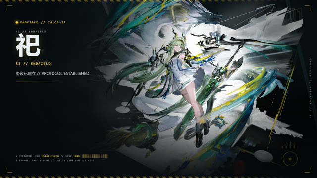
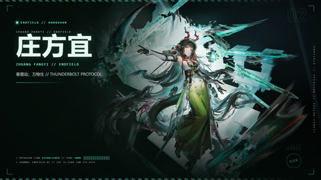
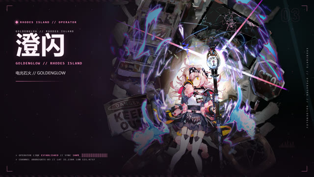
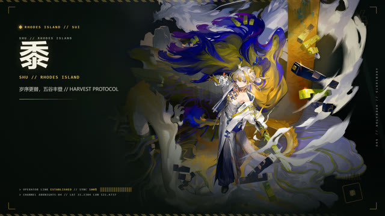

# Terra Skin Studio · 泰拉皮肤工坊

给 **Windows 版 OpenAI Codex Desktop（商店 / MSIX 版）** 换上一套《明日方舟》《明日方舟：终末地》主题：

**Codex 窗口内启动动画 + 应用内背景换肤 + 一键切换 + 自制 JPG/MP4 主题。**

主题通过 Chrome DevTools Protocol 注入到运行中的 Codex 页面，不修改 `app.asar`、不替换快捷方式、不注册开机自启；随时可以一键还原官方界面。


## 特性

- **应用内启动动画**：启动 Codex 时，动画直接盖在 Codex 窗口里播放，播完平面擦除进入已换肤界面；不是另开一个视频窗口。
- **一键换肤**：控制面板点主题卡片即切换；Codex 右下角 `TERRA` 胶囊也能直接换。
- **五套内置主题**：祀、庄方宜、澄闪、黍、佩丽卡；含背景、配色、HUD 装饰和 1080p 启动动画。
- **自定义主题**：上传 JPG/PNG/WebP 背景和 MP4 启动动画，自动从背景取色；视频只限制 64 MiB，不限制时长。
- **可逆**：还原原生界面、卸载脚本、回环豁免可撤销；不碰 Codex 安装文件。

## 主题预览

| 祀 · Si | 庄方宜 · Zhuang Fangyi |
| --- | --- |
|  |  |

| 澄闪 · Goldenglow | 黍 · Shu |
| --- | --- |
|  |  |

| 佩丽卡 · Perlica |
| --- |
|  |

## 快速开始

### 环境要求

- Windows，已安装 Microsoft Store / MSIX 版 OpenAI Codex Desktop。
- Node.js 22 或更新版本。
- 构建启动器需要 PowerShell 和 .NET Framework 4.8 x64 编译器。
- 普通构建不需要 `npm install`；Node 控制器只使用内置模块。

### 构建与启动

在项目根目录打开 PowerShell：

```powershell
npm run build
```

构建产物位于 `build\app\`。第一次使用时，为商店版 Codex 添加一次本机回环豁免：

```powershell
powershell -NoProfile -ExecutionPolicy Bypass -File build\app\scripts\enable-loopback.ps1
```

在 UAC 对话框中确认后，双击 `build\app\泰拉终端.bat` 启动 Codex 和主题动画。

### 打开控制面板

双击 `build\app\打开控制面板.bat`，或在浏览器打开：

```text
http://127.0.0.1:9342/
```

面板可以切换主题、创建自定义主题、调整外观参数、启动或重启 Codex、还原官方界面和查看日志。

## 日常使用

- 在面板中点主题卡片，或使用 Codex 窗口内的 `TERRA` 主题胶囊切换主题。
- “外观参数”可调整背景清晰度、面板不透明度、深色/纸白风格、正文可读性和启动动画设置。
- “还原原生界面”会移除注入的主题样式；之后仍可从面板重新应用主题。
- 使用面板“自定义主题”可上传背景图和可选 MP4。背景图会在浏览器本机裁切为 1920×1080 JPEG，原始图片不会上传。

## 自定义主题

不想改代码的话，直接在控制面板里：

1. 选择背景图（JPG/PNG/WebP）；
2. 点“从背景图取色”，自动填主色、辅色、表面色和文字色；
3. 可选上传一个 MP4 作为启动动画；
4. “创建并应用”。

自定义主题保存在 `%LOCALAPPDATA%\TerraStudio\themes\`，内置主题目录保持只读。

想从一张立绘生成完整主题（预览图、深色/纸白背景、1080p 动画），见 [主题格式与制作](docs/THEMES.md)。

## 注意事项

- 首次连接商店版 Codex 需要回环豁免。可用 `build\app\scripts\enable-loopback.ps1 -Status` 查看状态，用 `-Remove` 撤销。
- 如果 Codex 已运行但没有 CDP 调试端口，启动器可能询问是否重启。重启会关闭 Codex；未发送的输入可能丢失，请先保存。
- 默认端口为 CDP `9341`、控制面板 `9342`。服务只面向本机使用，不要将端口转发到局域网或公网。
- 应用内启动视频通过 CDP 传输上限为 64 MiB。超出时会回退到背景图；需要播放完整大视频时可试 `TerraBoot.exe --theme <主题id> --external`。
- `build/` 是生成目录。请修改 `src/`、`panel/`、`themes/` 中的源文件，再重新构建；直接编辑 `build/app/` 会在下次构建时被覆盖。
- 根目录 `LICENSE` 说明软件代码的 MIT 许可，不自动授予主题图像和视频的其他使用权；添加或替换素材前须确认其公开再分发授权。

## 文档

- [快速开始与常用操作](docs/GETTING_STARTED.md)
- [主题格式与制作](docs/THEMES.md)
- [故障排查](docs/TROUBLESHOOTING.md)
- [代码库结构、架构和维护说明](docs/README.md)
- [主题目录说明](themes/README.md)